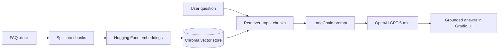

# 🧠 BRIHA · KnowledgeBot (RAG AI Chatbot)


     

> ⚡ **Part of [BRIHA](https://github.com/asad110abbas)** · Briha Research, built by Syed Asad Abbas.

A **retrieval-augmented generation (RAG)** chatbot that answers questions from your own documents.
Drop in a `.docx` FAQ and chat with it through a Gradio web UI.

## Architecture


## Highlights
- **LangChain** pipeline for loading, chunking, retrieval and prompting
- **Local embeddings** (Hugging Face) + **Chroma** vector search
- **Grounded answers** from OpenAI GPT-5-mini, using retrieved context only
- **Gradio** chat interface, running in one command

## Run
```bash
pip install langchain langchain-community langchain-openai langchain-huggingface chromadb python-docx gradio
export OPENAI_API_KEY="your-key"
python "RAG BASED AI CHATBOT.py"
```
